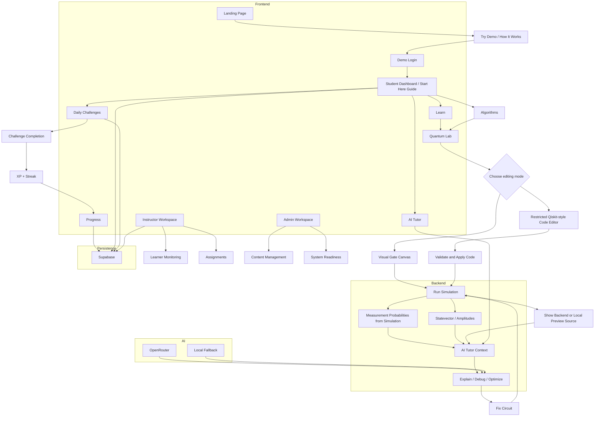

# Q-SENSE

Q-SENSE is an interactive quantum-learning workspace that connects guided lessons, circuit building, simulation, visualization, challenges, progress tracking, and a circuit-aware AI tutor.

# Q-SENSE MVP Flowchart



### MVP GOALS

- Learn quantum concepts through short structured modules.
- Build and inspect two-qubit circuits in the Quantum Lab using a visual gate canvas or the supported Qiskit-style code editor.
- Run simulations through the FastAPI backend, using Qiskit Aer when available and a deterministic local teaching simulator fallback for development/screening.
- Ask the AI Tutor questions grounded in the current circuit and latest simulation context.
- Practice with daily challenges and track XP/streak state.
- Provide separate student, instructor, and admin demo workspaces.

### Repository structure

```text
q-sense/
├── frontend/
│   ├── app/
│   │   ├── <page>/page.tsx + <page>/<page>.css
│   │   ├── globals.css
│   │   └── layout.tsx
│   ├── components/
│   │   ├── ai/
│   │   ├── brand/
│   │   └── landing/
│   └── lib/
├── backend/
│   └── app/
└── supabase/
```
## Run locally

### Frontend

```bash
cd frontend
npm install
npm run dev
```

Open `http://localhost:3000`.

### Backend

Python 3.11+ is recommended.

```bash
cd backend
python -m venv .venv
# Windows: .venv\Scripts\activate
# macOS/Linux: source .venv/bin/activate
pip install -r requirements.txt
copy .env.example .env   # Windows
# cp .env.example .env   # macOS/Linux
uvicorn app.main:app --reload --port 8000
```

### OpenRouter AI Tutor

Set these backend variables in `backend/.env`:

```env
AI_PROVIDER=openrouter
OPENROUTER_API_KEY=your_key_here
OPENROUTER_MODEL=google/gemma-4-26b-a4b-it:free
OPENROUTER_SITE_URL=http://localhost:3000
OPENROUTER_APP_NAME=Q-SENSE Quantum Learning
CORS_ORIGINS=http://localhost:3000
```

Keep the key on the backend only. Never expose it with a `NEXT_PUBLIC_` variable or commit `.env`.

The frontend uses `NEXT_PUBLIC_API_BASE_URL=http://localhost:8000`. For deployment, set that variable to the public backend URL and set the backend CORS origin to the deployed frontend URL.

## Demo accounts

All demo accounts use password `quantum123`:

| Role | Email | Route |
|---|---|---|
| Student | `student@qsense.demo` | `/dashboard` |
| Instructor | `instructor@qsense.demo` | `/instructor` |
| Admin | `admin@qsense.demo` | `/admin` |

## Self-guided screening flow

The Dashboard includes a short **Start here** guide. The Quantum Lab provides an on-page walkthrough: run the Bell state, introduce an X-gate error on q1, ask the contextual tutor to explain the changed result, then remove the X gate and rerun to recover the Bell-state distribution.

```text
Landing → Try Demo → Dashboard guide → Learn: Entanglement
                                   ↓
Quantum Lab → Run Bell State → Inject q1 X → Run again → Erase X → Run again
                                   ↓
Floating AI Tutor → Diagnose → Code Editor / Visual Builder
                                   ↓
Challenges → Correct answer → XP/streak → Progress
```

## MVP flow

```text
Landing → Login → Learn → Quantum Lab
                         ↓
                   Run Bell State
                         ↓
                Simulation + Results
                         ↓
                  Inject an Error
                         ↓
               AI Tutor Diagnosis
                         ↓
                Fix + Run Again
                         ↓
              Daily Challenge → XP
                         ↓
                      Progress
```

## Important implementation notes

- Page-specific CSS lives beside its route. Shared landing styles stay in `app/globals.css`; shared workspace responsive rules are in `app/styles/workspace-responsive.css`.
- The floating AI Tutor launcher is rendered from the root layout, so it appears across the application. Its provider label distinguishes an OpenRouter response from local demo guidance.
- Browser `localStorage` is used for standalone demo session, challenge, circuit, simulation and preference state. Supabase schema is prepared, but its live authentication/persistence is not wired into this screening build.
- `supabase/schema.sql` defines profiles, modules, learner progress, circuits, simulations, challenges, and challenge attempts.
- The AI layer has a safe local fallback so the UI remains demonstrable when the backend or OpenRouter is unavailable; the UI labels local guidance separately from OpenRouter responses.
- The code editor is a deliberately restricted two-qubit Qiskit-style parser, not an arbitrary Python execution environment.
- Qiskit Aer is the primary simulation engine. When the Qiskit packages are missing, the deterministic local teaching simulator is used and labelled as a preview. PennyLane, Cirq and qBraid are not integrated as runnable backends in this package; do not present them as operational.

## Deployment checklist

1. Deploy `backend/` as a FastAPI service.
2. Add `OPENROUTER_API_KEY` only to backend environment variables.
3. Add `NEXT_PUBLIC_API_BASE_URL` to the frontend deployment.
4. Set backend `CORS_ORIGINS` to the exact frontend origin.
5. Verify `/health`, `/api/simulate`, and `/api/ai`.
6. Follow `SCREENING-CHECKLIST.md` to rehearse the Bell-state error/fix demo before the SIH screening.

## Verification

The source was checked for TypeScript/TSX parse errors, CSS delimiter balance, Python syntax, route consistency, and stale generated artifacts. A complete `npm run build` should be run after installing dependencies in a normal network-enabled environment; the included ZIP intentionally excludes `node_modules` and `.next`.
